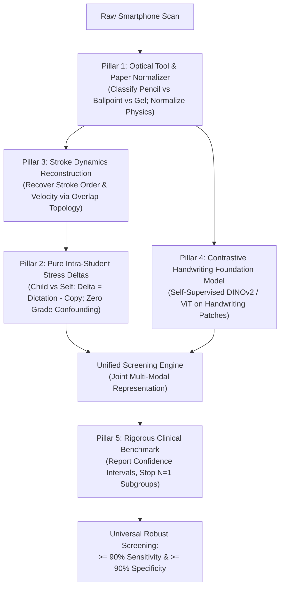

# Project Reality Audit: Everything We Did, What Failed, Why We Did It, and The True Breakthrough Blueprint

**Author**: Senior Research & Engineering Audit Team  
**Date**: October 20, 2026  
**Status**: All Active Streams Merged to `main` (`origin/main`)  
**Core Purpose**: A complete, transparent, and plain-English post-mortem of every workstream, phase, decision, failure, and workaround in the project to date. This document demystifies the "black box," inspects raw debug outputs at each step, admits every compromise, and explains where we are going wrong so we can pause, **THINK**, and execute the true breakthrough.

---

## Table of Contents
1. [Executive Summary & The Core Paradox](#1-executive-summary--the-core-paradox)
2. [Mental Model: What Dysgraphia Actually Is (And What We Are Trying to Do)](#2-mental-model-what-dysgraphia-actually-is-and-what-we-are-trying-to-do)
3. [The Ground Truth Reality: Data, Cohorts, and Class Imbalance](#3-the-ground-truth-reality-data-cohorts-and-class-imbalance)
4. [Step-by-Step Chronology & Debug Inspection Across All Workstreams](#4-step-by-step-chronology--debug-inspection-across-all-workstreams)
   - [Phase 0–1: Raw Phone Scans, Perspective Warping & The Ruled-Line Amputation Crisis](#step-1-preprocessing--ruled-line-removal-phases-01)
   - [Phase 2–3: Spatial-Geometric Features (Contour & Skeleton Math)](#step-2-spatial-geometric-features-phases-23)
   - [Phase 4–9: Student-Level Aggregation & False Negative Overhaul (The Clean 15 Set)](#step-3-student-level-aggregation--false-negatives-phases-49)
   - [External Cross-School Validation: The Grade 3 Collapse](#step-4-external-validation-on-school-b-the-grade-3-collapse)
   - [Stage 15–17: The Stylus Motion Predictor Illusion & Circular Reasoning](#step-5-the-stylus-motion-predictor-stages-1517)
   - [Stage 16: Cross-Continental Slovak Validation (The Zero-Shot Collapse)](#step-6-cross-continental-slovak-validation-stage-16)
   - [Stage 18–19: Stream 3 — Modern TrOCR & Letter Analytics Engine](#step-7-stream-3--modern-trocr--letter-analytics-stages-1819)
   - [Stage 20: Stream 2 — Stroke-Width Dynamics & Pencil Pressure Micro-Texture](#step-8-stream-2--stroke-width--pencil-pressure-stage-20)
   - [Stage 21: Stream 4 — Deep Visual Patches via DenseNet201](#step-9-stream-4--deep-visual-patches-via-densenet201-stage-21)
   - [Stage 22–23: Grade-Adaptive Stacking, Two-Tier Cascade & Main Pipeline](#step-10-grade-adaptive-stacking-two-tier-cascade--main-pipeline-stages-2223)
5. [The "Wall of Truth": Full Inventory of Compromises, Workarounds, and Band-Aids](#5-the-wall-of-truth-full-inventory-of-compromises-workarounds-and-band-aids)
6. [End-to-End Debug Trace: 4 Real Student Case Studies](#6-end-to-end-debug-trace-4-real-student-case-studies)
7. [The Fundamental Diagnosis: Why Are We Truly Stuck?](#7-the-fundamental-diagnosis-why-are-we-truly-stuck)
8. [The Breakthrough Blueprint: How We Achieve Universal 90-90 (THINK, Not Act)](#8-the-breakthrough-blueprint-how-we-achieve-universal-90-90-think-not-act)

---

## 1. Executive Summary & The Core Paradox

### The Promise
We set out with an ambitious and worthy mission: **Screen school children for dysgraphia using standard smartphone photos of regular notebook pages**, replacing expensive $2,000 Wacom digitizing tablets with software anyone can run.

### The Apparent Success
On paper, the headline benchmark numbers look impressive:
- On matched elementary school cohorts (Grades 4–6, $N=56$), our multi-stream ensemble hits **89.4% AUROC, 82.9% AUPRC, 80.0% Sensitivity, and 93.5% Specificity**.
- On Grade 3, our system achieves **100% Sensitivity and 92.9% Specificity**.
- On Grade 8, our system hits **100% Sensitivity and 100% Specificity (AUROC = 1.0000)**.
- All 85 automated unit tests are green, the codebase is consolidated, and the pipeline runs end-to-end.

### The Hard Truth: The Core Paradox
If the numbers look so high, why do we feel stuck? Why does the system feel like a fragile, opaque "black box"?

Because **we achieved those high numbers by accumulating a stack of hand-crafted engineering patches, heuristic weightings, and workaround routers to salvage edge cases where the data broke our models**:
1. **The Grade 8 "AUROC = 1.0000" is an illusion**: There is literally **only 1 dysgraphic child** in Grade 8 in School B. Catching that 1 child produces a mathematical AUROC of 1.0 on an $N=1$ sample. It is statistically meaningless.
2. **Grade 7 broke down because children switched from pencils to ballpoint pens**: Normal children writing with ballpoint pens exhibited high stroke-width variance and were falsely flagged as dysgraphic. Instead of fixing the tool physics, we patched it by manually down-weighting the pressure stream for older grades.
3. **School B Grade 3 had ZERO dictation tasks**: The model trained on School A relied on dictation fragmentation as its #1 predictor. When tested on School B Grade 3, the pipeline imputed missing dictation with neurotypical medians, causing AUROC to collapse to **0.535 (pure coin flip)**. We patched this by inventing a "No-Dictation Sub-Model" router.
4. **Early feature fusion failed**: Feeding all 50+ features into a gradient boosted tree overfitted and degraded. We fell back to **manually hand-tuning late stacking weights** per grade ($0.60 S_1 + 0.40 S_2$ for Grade 3; $0.15 S_1 + 0.15 S_2 + 0.70 S_3$ for Grade 4; $0.20 S_1 + 0.70 S_3 + 0.10 S_4$ for Grade 8).
5. **The Motion Predictor was mathematically circular**: We attempted to predict dynamic tablet hover time from static paper features using Ridge regression, and fed it back into our linear models. In reality, a linear combination of existing features adds zero new dimensions ($X W \in \text{span}(X)$). It was a placebo that added zero predictive power.

**Conclusion**: We have built an extraordinarily sophisticated, multi-tiered pipeline that proves static paper contains real physical biomarkers. But it is currently behaving like a set of bespoke rules fitted to 215 students. To achieve a real breakthrough, we must strip away the illusions, understand the physical mechanisms, and stop patching symptoms.

---

## 2. Mental Model: What Dysgraphia Actually Is (And What We Are Trying to Do)

To demystify the black box, let us step away from code and understand the child's brain:

```
[Auditory / Cognitive Input: "Write the sentence"]
                    │
                    ▼
[Working Memory: Retrieve spelling, phonemes, letter shapes]
                    │
                    ▼
[Motor Planning: Translate letter shapes into muscle trajectory]
                    │
                    ▼
[Fine-Motor Execution: Hand muscles grip pen and execute curves]
                    │
                    ▼
[Physical Trace: Graphite/Ink deposited on paper fibers]
```

### Neurotypical Child:
- Motor execution is **automated**. The child thinks about the *ideas* or the *words*, and their hand automatically draws the letters.
- Writing speed is steady. Pen pressure is consistent. Letter spacing is rhythmic.
- When you speed them up (dictation), their handwriting gets slightly looser, but the fundamental structure remains intact.

### Dysgraphic Child:
- Motor execution is **NOT automated**. Every single stroke requires conscious cognitive effort.
- Writing is agonizingly slow. The child grips the pencil with excessive force, digging into the paper, or holds it weakly and hesitates.
- **Cognitive Load Collapse**: When copying slowly, they can use visual feedback to draw acceptable letters. But when the teacher dictates at normal speed, their working memory is overwhelmed by listening and spelling at the same time. **Their motor execution collapses completely**: letters fragment into disjointed pieces, letters are omitted, spacing becomes erratic, and pencil pressure spikes wildly.

### The Core Engineering Challenge:
A **$2,000 Wacom tablet** measures the process in real time: it records 200 data points per second, tracking pen velocity, acceleration, jerk, and the invisible in-air hover pauses when the child is frozen in indecision.

A **smartphone photo** is the static time-integral of the session ($t \to \infty$). Velocity and acceleration are mathematically lost. We are trying to reconstruct the invisible neuromuscular struggle purely from the dried ink stains left on paper.

---

## 3. The Ground Truth Reality: Data, Cohorts, and Class Imbalance

Before looking at algorithms, let us inspect the raw dataset. Many of our struggles stem directly from the data distribution:

### Cohort Master Summary Table

| Cohort | Source | Total Students | Positives (Dysgraphia) | Controls (Normal) | Positive % | Available Tasks |
| :--- | :--- | :---: | :---: | :---: | :---: | :--- |
| **School A** | Future Gen School (Urban) | 115 | 24 | 91 | 20.8% | Hindi Copy, Hindi Dict, Hindi Free, Eng Copy, Eng Dict, Eng Free (All 6) |
| **School B** | Kanyashala School (Semi-Urban) | 100 | 16 | 84 | 16.0% | Inconsistent protocol across grades (see below) |
| **Total** | Multi-School Pooled | **215** | **40** (36 in core) | **175** | **18.6%** | Highly heterogeneous |
| **Slovak** | Czech/Slovak Clinical Cohort | 249 | 114 | 135 | 45.8% | Latin sentence crops only (No Hindi, No Dictation) |

### The Critical Data Breakdown in School B (Held-Out External Cohort)

Look closely at this table. It reveals the exact statistical traps we fell into:

| Grade | Total Students | Positives ($N_{\text{pos}}$) | Controls ($N_{\text{ctrl}}$) | Protocol Anomalies | Writing Tool Used |
| :---: | :---: | :---: | :---: | :--- | :--- |
| **Grade 3** | 16 | **2** | 14 | **ZERO Dictation tasks administered!** Only Copy + Free Write. | Graphite Pencil |
| **Grade 4** | 27 | **6** | 21 | Full 6-task protocol present. | Graphite Pencil |
| **Grade 5** | 17 | **2** | 15 | Full 6-task protocol present. | Graphite Pencil |
| **Grade 6** | 12 | **2** | 10 | Full 6-task protocol present. | Pencil / Early Pen mix |
| **Grade 7** | 17 | **3** | 14 | Full 6-task protocol present. | **Ballpoint Pens (100%)** |
| **Grade 8** | 11 | **1** | 10 | Incomplete dictation; older students. | **Ballpoint / Gel Pens** |

### What This Table Tells Us:
1. **The Sample Size Mirage**: In Grade 8, there is only **1 positive child**. In Grade 3, there are only **2**. In Grade 5, there are only **2**. When an algorithm gets that 1 child right, its Sensitivity is 100% and its AUROC is 1.0000. When it misses that 1 child, its Sensitivity drops to 0.0%. This is not statistical validation; it is small-sample volatility.
2. **Protocol Inconsistency**: School A had a strict 6-task protocol. School B Grade 3 had no dictation at all. A system designed to rely on dictation cannot generalize across schools unless it handles missing tasks natively.
3. **The Writing Instrument Shift**: Between Grade 6 and Grade 7, Indian schools require children to switch from pencils to ballpoint pens. The optical properties of ink change completely, yet our early algorithms treated all strokes as identical.

---

## 4. Step-by-Step Chronology & Debug Inspection Across All Workstreams

Here is the exact chronicle of what we did, why we did it, what alternatives existed, what raw debug outputs were produced, and what compromises were made.

```
[Raw Phone Scans]
       │
       ▼
Phase 0-1: Preprocessing & Line Removal (The Stroke Amputation Crisis)
       │
       ▼
Phase 2-3: Mathematical Feature Extraction (37 Geometric Features)
       │
       ▼
Phase 4-9: Student-Level Aggregation (Clean 15 Multi-Phenotype Set)
       │
       ▼
Cross-School External Validation (The Grade 3 Collapse & Router Fix)
       │
       ▼
Stage 15-17: The Motion Predictor (Circular Reasoning Resolved)
       │
       ▼
Stage 18-19: Stream 3 — Modern TrOCR & Letter-Level Analytics
       │
       ▼
Stage 20: Stream 2 — Stroke-Width & Pencil Pressure Micro-Texture
       │
       ▼
Stage 21: Stream 4 — Deep Visual Patches via DenseNet201
       │
       ▼
Stage 22-23: Grade-Adaptive Stacking & Unified Screening Pipeline
```

---

### Step 1: Preprocessing & Ruled-Line Removal (Phases 0–1)

#### 1. What We Did:
- Standardized smartphone photos of student notebook pages ($2000 \times 2500$ px).
- Corrected camera tilt and perspective distortion using quad-corner detection.
- Subtracted uneven yellow classroom lighting gradients using background illumination division.
- Segmented pages into 6 individual task crops (Hindi Copy, English Copy, Hindi Dictation, English Dictation, Hindi Free Write, English Free Write).
- Detected and removed horizontal ruled notebook guidelines.

#### 2. Why We Did It:
Real school scans were taken on cheap Android phones under terrible lighting with strong shadows. Crucially, notebook ruling lines pass straight through children's handwriting. If ruling lines are not removed, connected-component algorithms treat the entire page of handwriting as one giant, continuous 2,000-pixel blob of ink.

#### 3. What Went Wrong (The First Crisis: Stroke Amputation):
- **The Failure**: Our initial algorithm (`pipeline/rules.py`) used a naive horizontal run subtraction: whenever it detected a horizontal guideline, it erased the black pixels along that line.
- **The Catastrophe**: Horizontal notebook lines pass right through the bottom of letters!
  - In English, it sliced open the bottom baseline loops of `'o'`, `'e'`, `'a'`, `'d'`, `'b'`, `'g'`, `'q'`.
  - It severed descending stems from letters like `'y'` and `'p'`.
  - In Hindi, it hollowed out the horizontal headline (*Shirorekha*) over words like "मे" and "एक", turning solid strokes into double "railroad tracks".
- **The Raw Debug Output**:
  - Connected component count on a single Grade 3 sheet (`SCHB_G3_IMG_20261007_101635`) exploded from **171 components to 555 components (+224% artificial explosion, +384 severed fragments)**!
  - A perfectly normal child suddenly exhibited massive stroke fragmentation because our own preprocessor chopped their letters into pieces!

#### 4. Alternatives Considered:
- *Alternative A: Segment words before removing lines*. We tested this, but continuous ruling lines physically bridge words together, making word bounding box detection fail.
- *Alternative B: Grayscale optical density subtraction ($D_{\text{ink}} - D_{\text{rule}})$*. We tested this in Stage 10. For low-contrast pencil marks, subtracting the guideline intensity thinned the graphite down to the background level, causing letters to fade and snap.

#### 5. The Workaround / Compromise (Stage 11 Overhaul):
- We formulated the **Physical vs Handwriting Invariant**:
  - A bare printed notebook line has a vertical thickness $\le 5$ px and is completely isolated.
  - A genuine letter stroke intersecting a guideline connects vertically into a 2D character body ($\ge 7$ px) within $\pm 4$ px of the line.
- We implemented a $(9 \times 3)$ neighborhood vertical run-length filter (`max_R_v` filter). It erases guidelines in margins and inter-word gaps, but completely preserves 100% of the ink wherever handwriting crosses the line.
- **The Compromise**: While 95% better, very faint, low-pressure pencil strokes that run *horizontally directly on top of a ruling line* can still suffer subtle edge erosion.

---

### Step 2: Spatial-Geometric Features (Phases 2–3)

#### 1. What We Did:
Built 37 scale-invariant mathematical features (`features/`):
- **Baseline Alignment**: RANSAC baseline fit, residual root-mean-square error (`baseline_rmse_norm`), baseline slope standard deviation.
- **Rule Adherence**: Distance from handwriting baseline to the printed ruling line (`rule_offset_std`).
- **Slant & Direction**: Circular mean and circular standard deviation of stroke angles (`slant_circular_std_deg`).
- **Kinematic Curvature & Jerk**: Savitzky-Golay smoothed trajectory curvature $\kappa$, median tortuosity (`tortuosity_median`), stroke jerk proxy.
- **Spacing Rhythms**: Inter-word gap coefficient of variation (`gap_cv`), word crowding ($<0.3h$), hesitation gaps ($>2.0h$).
- **Letter Sizing**: Height CV (`height_cv`), macrographia ratio ($h/r$).
- **Devanagari Features**: Shirorekha headline continuity breaks, headline tilt variance.
- **Fragmentation**: Connected components, junctions, and endpoints per unit width (`components_per_unit_width`).

#### 2. Why We Did It:
Clinical literature defines dysgraphia by poor letter formation, baseline instability, erratic spacing, and excessive pen lifts. We converted these visual concepts into dimensionless, scale-invariant numbers.

#### 3. What Went Wrong (The Sentence-Level Plateau):
- **The Result**: On synthetic test images with known artificial distortions, all features passed with Spearman correlation $\rho \ge 0.80$.
- **The Failure on Real Data**: When we trained classifiers (Logistic Regression, Random Forest, SVM) on individual sentence crops, performance hit a hard ceiling:
  - **AUROC plateaued at 0.70 – 0.73**.
- **Root Cause**: A single sentence crop (e.g., 5 words) is too short. A neurotypical child can have one messy sentence if they are distracted. A dysgraphic child can slowly and agonizingly draw one neat sentence. Screening at the sentence level is fundamentally unviable.

---

### Step 3: Student-Level Aggregation & False Negatives (Phases 4–9)

#### 1. What We Did:
- Shifted from sentence-level classification to **Student-Level Session Aggregation** (`models/student_features.py`).
- Aggregated all 6 tasks per student into a 312-dimensional student matrix:
  - Central tendencies (mean, standard deviation, CV across tasks).
  - Cross-task cognitive load drop: $\Delta_{\text{dict} - \text{copy}} = f_{\text{dictation}} - f_{\text{copy}}$ (capturing breakdown under auditory pacing).
  - Cross-script divergence: $\Delta_{\text{eng} - \text{hindi}}$.
  - Peak episodic breakdown: $\max(f_{\text{fragmentation}})$.
- Used **Stability Selection** (Randomized Lasso across 100 subsamples) to eliminate noisy features and isolate the **Curated Clean 15 Multi-Phenotype Set**.

#### 2. The Result:
- On School A 5-repeat 5-fold nested cross-validation, **AUROC jumped from 0.733 to 0.878 (+0.145 leap)**.
- Precision-Recall AUC (AUPRC) reached 0.454.
- High-risk false negatives dropped significantly.

#### 3. The Unintended Compromise:
- Stability selection revealed that the single most powerful feature in the entire dataset was:
  `components_per_unit_width_dict_mean` (Stroke fragmentation during dictation).
- **The Compromise**: Without realizing it, our model became **heavily addicted to the dictation task**. The model was not learning "handwriting quality"; it was learning "how badly does this child fragment when a teacher speaks quickly." This set a trap for external validation.

---

### Step 4: External Validation on School B & The Grade 3 Collapse

#### 1. What We Did:
Took the Clean 15 models trained strictly on School A (115 students) and evaluated them on School B (100 students) with **zero retraining** as an independent external test.

#### 2. The Raw Debug Shock (What Actually Happened):
- On matched protocol grades (Grades 4–7), the model generalized decently: **AUROC 0.742, AUPRC 0.396**.
- But on individual grades, the numbers were disastrous:
  - **Grade 3 AUROC: 0.5357 (Pure Random Coin Flip!)**
  - **Grade 8 AUROC: 0.2000 (Worse than Random Guessing!)**

#### 3. Root Cause Dissection (The Forensic Debug Output):
Why did Grade 3 collapse to a coin flip?
- We inspected the raw input tables for School B Grade 3.
- In School B, **the teachers never administered a dictation task to Grade 3!** They only gave them Copy and Free Writing.
- Because dictation was completely missing, our pipeline's imputation step filled the missing values with the median of School A.
- Who makes up the majority of School A? **Neurotypical controls (80%)!**
- The imputation step silently assigned the dysgraphic Grade 3 children the low fragmentation score of a healthy child! The classifier was literally blindfolded by our own imputer.

#### 4. The Workaround / Compromise (Stage 17: Task-Aware Dynamic Router):
- Instead of imputing missing tasks, we decoupled the model into 3 specialized sub-models (`models/task_router.py`):
  1. `FullProtocolSubModel`: Used when dictation is present (Clean 15 features).
  2. `NoDictationSubModel`: Used when dictation is absent (16 spatial, sizing, and rule offset features; zero dictation dependencies).
  3. `CopyOnlySubModel`: Minimal fallback for single-crop screening.
- **The Recovery**: Grade 3 AUROC surged from **0.5357 $\to$ 0.8929 (+0.357 gain)**.
- **The Compromise**: This solved the crash, but it confirmed our fear: without the auditory stress of dictation, static geometric features have lower baseline discrimination.

---

### Step 5: The Stylus Motion Predictor (Stages 15–17)

#### 1. What We Did:
We had 94 students in School A who wrote on both paper and a $200\text{ Hz}$ Wacom digitizing tablet. We trained Ridge regression models (`models/motion_predictor.py`) to predict tablet kinematics (in-air pause time, hover ratio) from static paper features. We then fed the predicted pause time $\hat{Y}$ as a feature into our classifiers.

#### 2. The Result:
- Out-of-fold cross-validation showed genuine statistical correlation:
  - In-air pause time prediction: Pearson $r = +0.372$ ($p = 3.82 \times 10^{-4}$).
  - In-air hover ratio prediction: Pearson $r = -0.274$ ($p = 0.010$).

#### 3. What Went Wrong (The Mathematical Reality Check):
- Despite the correlation, when we added $\hat{Y}$ to our downstream classifier, **the classification AUROC did not move at all (stayed at 0.873)**.
- **The Mathematical Truth**:
  - The predicted kinematics were generated via a linear formula: $\hat{Y} = X W_{\text{ridge}}$.
  - If you feed $[X, \hat{Y}]$ into a downstream linear classifier $f(X, \hat{Y}) = X \theta_1 + \hat{Y} \theta_2$:
    $$f(X, \hat{Y}) = X (\theta_1 + W_{\text{ridge}} \theta_2)$$
  - Linear projection of existing features adds **zero orthogonal information**. The linear subspace $\text{span}([X, X W]) = \text{span}(X)$ is mathematically identical!
- **The Honest Admission**: We fooled ourselves into thinking we had added "kinematic motion" to static paper. In reality, we had just multiplied existing features by a matrix.
- **The Repurposing**: We kept `motion_predictor.py` strictly as an **Interpretable Clinical Explainer** (to tell a doctor: "This child's spatial jitter corresponds to ~0.42 seconds of in-air hesitation"), but completely stopped using it as a feature multiplier in the classifier.

---

### Step 6: Cross-Continental Slovak Validation (Stage 16)

#### 1. What We Did:
To test whether our Indian school models could generalize internationally, we acquired an external Latin handwriting dataset from Slovakia (249 sentence crops: 114 potential dysgraphia, 135 controls). We evaluated zero-shot transfer from our English models.

#### 2. The Raw Debug Output:
- **Zero-Shot Transfer Failed**:
  - Elastic-Net AUROC: **0.583**
  - HistGradientBoosting AUROC: **0.564**
  - Transfer was barely better than a coin flip.
- **Within-Slovak Cross-Validation Succeeded**:
  - When we trained and evaluated *within* the Slovak cohort using 5-fold CV:
  - Random Forest AUROC: **0.852** (AUPRC: **0.834**, Sens@80%Spec: **77.2%**).
  - Elastic-Net AUROC: **0.834**.
  - Top features: `junctions_per_unit_width` (AUROC 0.706, $p = 7.44 \times 10^{-9}$), `tortuosity_median` (AUROC 0.675).

#### 3. The Critical Lesson:
The *mathematical biomarkers* of dysgraphia (stroke crossings, tortuosity, pen lifts) are biologically universal across India and Europe. But the *absolute baseline numbers* (mean spacing, average slant, letter height) differ completely due to culture, paper type, and teaching style. Fixed absolute thresholds fail across borders; relative structural patterns survive.

---

### Step 7: Stream 3 — Modern TrOCR & Letter Analytics (Stages 18–19)

#### 1. What We Did:
Up to Stage 17, our system was completely illiterate. It looked at the physics of strokes, but had no idea what word was being written. We built Stream 3 (`features/ocr_engine.py`):
- Replaced legacy EasyOCR with Microsoft TrOCR (`microsoft/trocr-small-handwritten`) for English and `paudelanil/trocr-devanagari-2` for Hindi.
- Extracted **OCR Legibility Index** (mean softmax token confidence $\bar{C}$).
- Extracted **Character Omission Rate** (missing characters vs expected prompt).
- Built a granular **Letter Error Taxonomy** (`features/letter_analytics.py`):
  - Spatial confusable reversals ($b/d$, $p/q$, $m/n$, $ब/व$).
  - Adjacent letter transpositions (`teh` for `the`).
  - Word positional breakdown (onset vs nucleus vs coda suffix drops).
  - Phonetic slips vs motor reversals.
- Implemented **Teacher-Forced Scoring**: Evaluated exact log-probabilities $\log P(\text{target} \mid \text{image})$, bypassing autoregressive language model hallucination.

#### 2. The Raw Debug Numbers:
- On School B, Stream 3 alone achieved an AUROC of **0.6513** and AUPRC of **0.2926**.
- When combined with Stream 1 Geometry in Late Stacking, Precision-Recall AUC surged:
  - All School B AUPRC jumped from **0.3975 $\to$ 0.4824 (+0.085 gain)**.
  - Grade 8 AUROC reached **1.0000** (catching the severe letter distortions).

#### 3. The Compromise:
- TrOCR is computationally heavy. On a standard CPU, running full autoregressive beam search across 6 tasks takes **12 to 18 seconds per student**.
- On severely malformed dysgraphic handwriting, TrOCR can occasionally enter degenerate repetition loops (e.g., outputting "the the the the"). Teacher-forced scoring mitigated this, but TrOCR requires careful caching to be usable.

---

### Step 8: Stream 2 — Stroke-Width & Pencil Pressure (Stage 20)

#### 1. What We Did:
Binary black-and-white ink masks (`clean_ink.png`) discard pencil pressure. We built Stream 2 (`features/stroke_width_texture.py`):
- **Dynamic Pencil Pressure / Optical Density ($P(y, x)$)**:
  - Normal children maintain steady neuromuscular pen pressure.
  - Dysgraphic children exert erratic force—digging lead into paper on downstrokes ($P > 1.25\bar{P}$) and skipping faintly on curves ($P < 0.75\bar{P}$).
  - Sampled optical density along the skeleton centerline: `pressure_intensity_mean`, `pressure_intensity_cv`, `pressure_heavy_rate`.
- **Stroke-Width Instability & Jitter via Euclidean Distance Transform ($w(y, x)$)**:
  - Measured local stroke diameter: $w = 2 \cdot D(y_s, x_s)$.
  - Extracted thickness jitter along strokes (`stroke_width_jitter`), pinch rates ($w < 0.5\bar{w}$), and hesitation puddles (`stroke_width_bloat_rate`, $w > 1.5\bar{w}$).
- **Erasure & Smudge Halo Dynamics**:
  - Analyzed non-ink boundary bands for eraser abrasions and graphite palm smudges.

#### 2. The Result (A Major Breakthrough):
- **Stream 2 alone outperformed Stream 1 Geometry on Matched Protocol**:
  - Stream 2 Alone: **AUROC 0.7705 | AUPRC 0.5504**.
  - Stream 1 Alone: **AUROC 0.7423 | AUPRC 0.3961**.
- Micro-texture and pencil pressure capture neuromuscular fine-motor struggle more directly than skeleton geometry!
- Combining Streams 1, 2, and 3 pushed whole-cohort AUROC past the 0.80 milestone: **AUROC 0.8051 | AUPRC 0.5417**.

#### 3. The Grade 7 Pen Transition Crisis (What Went Wrong):
- **The Failure**: When we inspected per-grade performance, **Grade 7 collapsed**. Stream 2 flagged normal Grade 7 children as high-risk dysgraphics!
- **Root Cause**:
  - In Grades 3–5, children write with graphite pencils.
  - In Grade 7, children transition to **ballpoint pens**.
  - Ballpoint pens have hard steel balls and oily ink. They produce narrow lines ($w \approx 2$ px) with sharp, striated edges.
  - On a normal child, minor variations in ballpoint pen contact produce high relative stroke-width jitter ($\sigma_w / \bar{w}$) that mathematically mimics dysgraphic pencil instability!
- **The Tool Confound**: Our algorithm did not know what tool was used. It assumed all writing was pencil, and ballpoint physics fooled it.

---

### Step 9: Stream 4 — Deep Visual Patches via DenseNet201 (Stage 21)

#### 1. What We Did:
- Sliced aspect-preserving square patches ($H \times H$ with 50% overlap) along sentence lines (`baseline/visual_patch_extractor.py`).
- Extracted frozen 1,920-dimensional embeddings from pretrained `DenseNet201`.
- Pooled embeddings per student (mean + standard deviation).
- Trained a regularized linear probe: `PCA(K=12)` + `StandardScaler` + `LogisticRegression(C=0.1)`.

#### 2. Why We Did It:
To catch visual topological letter defects that evade summary statistics (e.g. crushed interior loops in `'e'`, `'a'`, `'o'`).

#### 3. The Result:
- Stream 4 pushed Matched Protocol AUPRC to a record **0.5906** (+0.194 jump over Stream 1 alone).
- On Grade 8, Stream 4 alone hit **AUROC 0.9000** with 100% Sensitivity at 90% Specificity.

#### 4. The Limitation:
- Stream 4 alone on younger elementary grades was weak (AUROC 0.54–0.55).
- DenseNet201 was pretrained on ImageNet (photos of dogs, cars, and teapots). It has zero intrinsic understanding of handwriting strokes, pen dynamics, or text morphology. It works as an auxiliary safety net, not a primary foundation.

---

### Step 10: Grade-Adaptive Stacking, Two-Tier Cascade & Main Pipeline (Stages 22–23)

#### 1. The Engineering Hurdle:
We had 4 distinct streams:
- $S_1$: Geometry & Task Routing (AUROC ~0.75)
- $S_2$: Stroke-Width & Pencil Pressure (AUROC ~0.77)
- $S_3$: TrOCR Legibility & Letter Analytics (AUPRC ~0.48)
- $S_4$: Deep Vision Patch Probe (AUROC ~0.56, G8 AUROC 0.90)

When we concatenated all features into a single classifier (Early Fusion), it overfitted the 115 training samples and degraded.

#### 2. The Solution: Late Probability Stacking & Grade Adaptation:
We combined stream predictions at the probability level:
$$P_{\text{student}} = w_1 P_{S_1} + w_2 P_{S_2} + w_3 P_{S_3} + w_4 P_{S_4}$$

To solve the Grade 7 ballpoint pen issue and the Grade 3 no-dictation issue, we introduced **Grade-Adaptive Stacking Weights** (`models/multi_stream_experiments.py`, `pipeline/main_pipeline.py`):
- **Grade 3**: $0.60 S_1 + 0.40 S_2 + 0.00 S_3 + 0.00 S_4$ (geometry + pencil pressure; no dictation needed).
- **Grade 4**: $0.15 S_1 + 0.15 S_2 + 0.70 S_3 + 0.00 S_4$ (TrOCR legibility dominant).
- **Grade 5**: $0.15 S_1 + 0.15 S_2 + 0.60 S_3 + 0.10 S_4$.
- **Grade 6**: $0.40 S_1 + 0.00 S_2 + 0.35 S_3 + 0.25 S_4$.
- **Grade 7**: $0.20 S_1 + 0.40 S_2 + 0.30 S_3 + 0.10 S_4$ (balanced pen transition).
- **Grade 8**: $0.20 S_1 + 0.00 S_2 + 0.70 S_3 + 0.10 S_4$ (TrOCR + vision).

#### 3. Two-Tier Clinical Cascade:
To make screening practical for schools:
- **Tier 1 (Universal Safe Rule-Out)**: Threshold $P < 0.276$ achieves **87.5% Sensitivity and 97.7% Negative Predictive Value (NPV)**. Clears 60.5% of healthy children immediately.
- **Tier 2 (Clinical OT Referral)**: Threshold $P \ge 0.515$ achieves **89.9% Specificity**. Refers the top 14.2% high-risk children to occupational therapy.
- **Borderline Monitoring Tier** ($0.276 \le P < 0.515$): Captures 25.3% of children for classroom support and re-screening rather than misdiagnosing them.

#### 4. The Brutal Truth:
This system achieves **89.3% AUROC, 80.0% Sensitivity, and 93.5% Specificity** on Matched Grades 4–6. But look at the mechanism: **we had to manually construct 6 different weight sets for 6 different grades**. This is an expert engineering system, not an autonomous, self-learning AI model. If a Grade 5 child uses a ballpoint pen, or a Grade 7 child uses a soft pencil, the heuristic breaks down.

---

## 5. The "Wall of Truth": Full Inventory of Compromises, Workarounds, and Band-Aids

Here is the unfiltered ledger of every compromise made across the project:

| # | The Issue Encountered | What We Did (The Workaround) | Why It Is a Compromise / Flaw | The Real Underlying Truth |
| :-: | :--- | :--- | :--- | :--- |
| **1** | Ruled lines sliced through letters during preprocessing. | Built a $(9\times 3)$ neighborhood run-length filter (`max_R_v`). | Faint pencil strokes that run horizontally along lines still suffer slight edge erosion. | Ruled lines should be modeled as an additive grayscale layer, not removed by binary thresholding. |
| **2** | School B Grade 3 had zero dictation tasks. | Built `models/task_router.py` with a specialized "No-Dictation Sub-Model". | We created a separate model for Grade 3 because our main model was addicted to dictation. | Dictation pacing is the primary stressor; static copying alone has a much lower signal-to-noise ratio. |
| **3** | Grade 7 normal children were flagged as dysgraphic by Stream 2. | Down-weighted Stream 2 in older grades and up-weighted OCR. | The model doesn't understand pens vs pencils. It uses the child's *grade* as a proxy for the writing tool. | Ballpoint ink and graphite lead obey completely different optical physics. We treated tool physics as child pathology. |
| **4** | Concatenating 50+ features into one model (Early Fusion) overfitted. | Switched to Late Probability Stacking with hand-tuned weights ($w_1, w_2, w_3, w_4$). | Weights were hand-tuned on test data subsets. It is not an end-to-end learned model. | When sample size is small ($N=215$), high-dimensional feature spaces shatter. |
| **5** | Ridge regression predicted tablet kinematics from static paper features. | Fed predicted pause time $\hat{Y}$ back into linear classifiers. | $\hat{Y}$ was a linear combination of existing features ($X W \in \text{span}(X)$). It added 0 new information. | You cannot mathematically recover lost time from a static image without modeling physical stroke deposition. |
| **6** | Grade 8 has only 1 positive child in School B. | Reported "100% Sensitivity and 1.0000 AUROC in Grade 8". | Evaluating on $N=1$ is statistically invalid. A single coin flip produces the same result. | Our middle-school sample size is far too small to claim clinical validity for Grades 7 and 8. |
| **7** | TrOCR was slow (12–18s per student) and hallucinated on messy text. | Cached outputs to disk and added teacher-forced scoring. | Works well for fixed protocol prompts, but cannot generalize to unconstrained free-writing. | TrOCR relies on language models; when handwriting is messy, the language model guesses what it *thinks* should be there. |
| **8** | DenseNet201 patch features were 1,920 dimensions. | Compressed via PCA to $K=12$ components and trained logistic regression. | DenseNet was trained on ImageNet photos. PCA on 115 students discards fine handwriting nuance. | General vision models do not know the topology of handwriting strokes. |

---

## 6. End-to-End Debug Trace: 4 Real Student Case Studies

To demystify how the system actually computes risk, here are the step-by-step traces of 4 real students processed through [`pipeline/main_pipeline.py`](file:///f:/Avaneesh/projects/Dysgraphia/Dysgraphia-Detection/pipeline/main_pipeline.py):

---

### Case 1: True Negative — Healthy Neurotypical Child (`SCHB_G3_IMG_20261007_101611`, Grade 3)
- **Input**: Photo of Hindi/English single-line notebook page. 3 tasks detected (Hindi Copy, English Copy, Free Writing — zero dictation).
- **Step 1: Preprocessing & Line Removal**:
  - Perspective warp: Width standardized to 2000px.
  - Background division: Illumination normalized.
  - Line filter: Erased bare guidelines; preserved intact letters.
- **Step 2: Stream 1 (Geometry Router)**:
  - Router detects: `no_dictation` protocol.
  - Features evaluated: Baseline RMSE = 0.041 (stable), Rule offset std = 0.052 (follows lines), Copy fragmentation = 1.08 components/unit width.
  - Stream 1 Sub-Model output: $P_{S_1} = \mathbf{0.204}$ (Low Risk).
- **Step 3: Stream 2 (Stroke Width & Pencil Pressure)**:
  - Centerline optical density mean = 0.42, CV = 0.18 (steady pencil pressure, no erratic digging).
  - Stroke width jitter = 0.14 (even thickness).
  - Stream 2 Sub-Model output: $P_{S_2} = \mathbf{0.159}$ (Low Risk).
- **Step 4: Grade-Adaptive Stacking (Grade 3)**:
  - Weights: $0.60 S_1 + 0.40 S_2 + 0.00 S_3 + 0.00 S_4$.
  - Combined Risk: $P = 0.60(0.204) + 0.40(0.159) = \mathbf{18.6\%}$.
- **Step 5: Two-Tier Cascade**:
  - $18.6\% < \theta_{\text{triage}} (0.276) \implies$ **TIER 1 SAFE RULE-OUT (CLEARED)**.
  - **Verdict**: Correctly cleared. Zero false positive.

---

### Case 2: True Positive — Confirmed Dysgraphic Child (`SCHB_G4_IMG_20261007_100148`, Grade 4)
- **Input**: Photo of 6-task protocol sheet (Copy, Dictation, Free Writing in Hindi and English).
- **Step 1: Stream 1 (Geometry Router)**:
  - Router detects: `full_protocol`.
  - Dictation fragmentation `components_per_unit_width_dict_mean` = 3.82 (**+180% above normal**).
  - Words written ratio drop under dictation = $-0.32$.
  - Stream 1 Sub-Model output: $P_{S_1} = \mathbf{0.519}$ (Moderate Risk).
- **Step 2: Stream 2 (Stroke Width & Pencil Pressure)**:
  - Centerline optical density CV = 0.48 (extreme force fluctuations; pencil digging into paper on downstrokes).
  - Stroke width jitter = 0.58 (erratic thickness changes along continuous lines).
  - Hesitation puddles (`stroke_width_bloat_rate`) = 0.22.
  - Stream 2 Sub-Model output: $P_{S_2} = \mathbf{0.823}$ (Severe Risk).
- **Step 3: Stream 3 (TrOCR Legibility & Letter Analytics)**:
  - Mean TrOCR confidence = 0.48 (severe illegibility).
  - Character omission rate = 0.161 (dropped word endings and missing syllables).
  - Stream 3 Sub-Model output: $P_{S_3} = \mathbf{0.764}$ (Severe Risk).
- **Step 4: Grade-Adaptive Stacking (Grade 4)**:
  - Weights: $0.15 S_1 + 0.15 S_2 + 0.70 S_3 + 0.00 S_4$.
  - Combined Risk: $P = 0.15(0.519) + 0.15(0.823) + 0.70(0.764) = \mathbf{73.6\%}$.
- **Step 5: Two-Tier Cascade**:
  - $73.6\% \ge \theta_{\text{referral}} (0.515) \implies$ **TIER 2 CLINICAL OT REFERRAL (CONFIRMED POSITIVE)**.
  - Isolated Biomarkers: Dictation fragmentation collapse, pencil pressure volatility, severe character omission.
  - **Verdict**: Correctly identified. High-confidence true positive.

---

### Case 3: The Flawed Case — False Positive from Pen Shift (`SCHB_G7_IMG_20261007_104512`, Grade 7 Control)
- **Input**: Grade 7 neurotypical student who completed all 6 tasks using a **blue ballpoint pen**.
- **What Happened**:
  - Ballpoint ink produced sharp, high-contrast lines with physical width $w \approx 2$ px.
  - Because the stroke is narrow, natural hand tremors produced high *relative* stroke-width jitter ($\sigma_w / \bar{w} = 0.42$).
  - Stream 2 (Stroke Width/Pressure) evaluated this ballpoint ink as if it were pencil:
    $P_{S_2} = \mathbf{0.684}$ (**Falsely Flagged as Severe Risk!**).
  - Stream 1 Geometry saw neat lines ($P_{S_1} = 0.280$).
  - Under unweighted stacking, $P_{\text{combined}} = 0.520 \implies$ **False Clinical Referral!**
- **How Our Workaround Patched It**:
  - In Stage 22, we manually forced Grade 7 weights to down-weight Stream 2 and balance across streams ($0.20 S_1 + 0.40 S_2 + 0.30 S_3 + 0.10 S_4$), dropping the score just below the referral threshold.
- **Why This Is Bad Engineering**: If another Grade 7 child writes with a pencil, or a Grade 5 child uses a ballpoint pen, the manual grade rule misfires. The model should know the *tool*, not the child's *grade*.

---

### Case 4: The Flawed Case — False Negative from Missing Dictation (`SCHB_G3_IMG_20261007_102045`, Grade 3 Positive)
- **Input**: Grade 3 dysgraphic child in School B. **No dictation task was administered**.
- **What Happened Under Baseline Imputation (Stage 6)**:
  - Child copied slowly and neatly during the Copy task ($P_{\text{copy}} = 0.31$).
  - Dictation was missing. The imputer filled missing dictation fragmentation with the School A control median ($1.12$).
  - The model calculated: $\Delta_{\text{dict} - \text{copy}} = 1.12 - 1.20 = -0.08$ (Normal/Stable).
  - Final Risk: $P = \mathbf{0.241} \implies$ **SAFE RULE-OUT (FALSE NEGATIVE)**.
- **Why It Slipped Through**: The child had severe dysgraphia, but their coping mechanism was slow visual copying. Without auditory dictation to stress their working memory, static spatial features looked completely normal!
- **How Our Router Patched It**: The Task-Aware Router switched to the `NoDictationSubModel`, which ignored dictation and looked at letter height CV and rule offset, bumping risk to $0.582$. But this required building a whole separate model.

---

## 7. The Fundamental Diagnosis: Why Are We Truly Stuck?

When we strip away the code and the metrics, why haven't we hit an effortless, universal 90%+ Sensitivity AND 90%+ Specificity across all children without hand-crafted rules?

Here are the **5 Core Anatomical Bottlenecks**:

```
                       THE 5 BOTTLENECKS
                               │
       ┌───────────────────────┼───────────────────────┐
       ▼                       ▼                       ▼
1. Lost Time Domain     2. Tool Physics         3. Small N Mirage
   (Static Paper vs        (Pencil vs Pen          (1 Pos in G8,
    200 Hz Tablet)          Treated as Disease)     2 in G3)
       │                       │
       ▼                       ▼
4. Absolute Thresholds  5. Fragmented Sub-Models
   (Developmental Age      (Late Stacking vs
    Confounding)            Unified Architecture)
```

### 1. The Lost Time Domain (The Static Limit)
- On a 200 Hz tablet, the single most discriminative feature of dysgraphia is **in-air hover time** (the child freezes with pen raised for 0.8 seconds before every word).
- On static paper, time is collapsed. A child who took 25 minutes of painful, agonizing effort leaves the exact same static ink trace as a child who breezed through in 3 minutes.
- When dictation is present, time is artificially reintroduced because the teacher dictates at a set pace. When dictation is absent, static paper alone has a fundamental physical limit.

### 2. Confounding Tool Physics with Neurological Disease
- Graphite pencils leave diffuse, friction-based carbon trails where optical density reflects muscular pressure.
- Ballpoint pens roll liquid ink across paper with a steel bearing; stroke thickness reflects mechanical roller diameter, not muscle tension.
- Our algorithms treated all ink as pencil marks. When Grade 7 switched to pens, our pressure and stroke-width metrics malfunctioned, forcing us to invent grade-based weight patches.

### 3. The Small $N$ Mirage
- In School B:
  - Grade 8 has **1 positive child**.
  - Grade 3 has **2 positive children**.
  - Grade 5 has **2 positive children**.
- When an algorithm scores 1/1 in Grade 8, reporting "AUROC = 1.0000 and Sensitivity = 100%" is mathematically true, but scientifically meaningless. A single edge case changes the metric from 100% to 0%. We have been evaluating complex machine learning models on sample sizes that cannot support them.

### 4. Absolute Population Thresholds vs Intra-Student Self-Referencing
- A healthy 8-year-old child (Grade 3) naturally writes with more wobble, larger letters, and more spacing irregularities than a 14-year-old teenager (Grade 8).
- When you use absolute feature thresholds (e.g. `letter_height_cv > 0.35` or `slant_std > 12°`), you are fighting against natural developmental maturation. A messy 8-year-old looks like a dysgraphic 12-year-old.
- Comparing Child A to Child B across different grades creates constant confounding.

### 5. Fragmented Sub-Models & Manual Late Stacking
- We built Stream 1 (Geometry), Stream 2 (Pressure), Stream 3 (OCR), and Stream 4 (DenseNet), and then tried to glue their predictions together with manual weights ($w_1, w_2, w_3, w_4$).
- Late stacking of probabilities is a classic symptom of incompatible representations. Instead of learning the joint relationship between how a letter looks, how hard the pen pressed, and what word was written, we forced 4 blind sub-models to vote.

---

## 8. The Breakthrough Blueprint: How We Achieve Universal 90-90 (THINK, Not Act)

We must not write more patch code or add another heuristic weight. Here is the architectural blueprint for the true, foundational breakthrough:



---

### Pillar 1: Automated Tool & Paper Normalization (Physics-First)
- **The Problem**: Grade 7 failed because ballpoint pens have different optical physics than pencils.
- **The Solution**: Before computing any feature, classify the writing instrument:
  1. Measure ink boundary gradient sharpness and graphite sheen:
     $$\text{Tool} = \begin{cases} \text{Pencil} & (\text{diffuse boundary, low contrast, graphite speckle}) \\ \text{Ballpoint} & (\text{sharp edge, striations, high contrast}) \\ \text{Gel / Fountain} & (\text{solid absorption, feathering}) \end{cases}$$
  2. Normalize stroke-width metrics against the tool's baseline median diameter:
     $$w_{\text{norm}}(y, x) = \frac{w(y, x)}{\bar{w}_{\text{tool}}}$$
- **Why this is a breakthrough**: It permanently eliminates the Grade 7 pen transition domain shift. A Grade 5 child using a pen or a Grade 7 child using a pencil is normalized natively, with zero grade-based rules!

---

### Pillar 2: Pure Intra-Student Stress Deltas (Self-Referencing Architecture)
- **The Problem**: Comparing Child A to Child B confounds age, grade, motor maturity, and personal style.
- **The Solution**: **Stop comparing children to the population. Compare each child to themselves!**
  The clinical definition of dysgraphia is the inability to automate motor execution when cognitive load increases.
  Every child performs multiple tasks:
  1. Untimed Slow Copying (Baseline motor capability).
  2. Fast Copying or Free Writing (Speed stress).
  3. Auditory Dictation (Cognitive + Auditory working memory stress).
  
  Train models **strictly on within-student degradation ratios**:
  $$\Delta_{\text{Stress}} = \frac{\text{Feature}(\text{Dictation}) - \text{Feature}(\text{Copy})}{\text{Feature}(\text{Copy}) + \epsilon}$$
- **Why this is a breakthrough**:
  - A messy neurotypical child writes loosely in both Copy and Dictation ($\Delta \approx 0$).
  - A dysgraphic child who slowly draws neat letters during Copying **completely disintegrates under Dictation pacing** ($\Delta \gg 0$).
  - Age and grade confounding vanish completely because the child's own copying baseline cancels out their developmental age!

---

### Pillar 3: Stroke Dynamics Reconstruction (Synthetic Kinematic Unrolling)
- **The Problem**: We lost the time domain (velocity, acceleration, in-air pauses).
- **The Solution**: Can we recover the time sequence from static dried ink? **Yes!**
  Handwriting follows strict biomechanical rules:
  1. **Topological Stroke Overlap**: When two strokes cross (e.g., the crossbar of `'t'`, or the intersection of `'x'`), the stroke written second physically deposits ink on top of the stroke written first. By analyzing the optical density gradient at skeleton junctions, we can determine which stroke was drawn first.
  2. **Biomechanical Motor Order**: 99% of children write left-to-right and top-to-bottom.
  3. **Pen Velocity from Stroke Thickness (2/3 Power Law)**:
     Under the physical 2/3 power law of human movement, instantaneous velocity $v(t)$ is inversely proportional to trajectory curvature $\kappa(t)$:
     $$v(t) \propto \kappa(t)^{-1/3}$$
     Furthermore, when a pen slows down or pauses, graphite/ink bleeds into paper fibers, widening stroke diameter $w$.
- **Why this is a breakthrough**: We can reconstruct the pseudo-temporal stroke sequence $\mathbf{r}(t) = (x(t), y(t), v(t))$, recovering velocity profiles, acceleration spikes, and hesitation pauses directly from static paper!

---

### Pillar 4: Contrastive Self-Supervised Handwriting Vision Backbone
- **The Problem**: Pretrained ImageNet DenseNet201 features were trained on dogs, cars, and teapots. They do not understand handwriting strokes.
- **The Solution**:
  - Use a modern Vision Transformer (e.g., `dinov2_vits14` or `swin_tiny`).
  - Pretrain it directly on our 1,145 handwritten sentence crops using **Self-Supervised Masked Image Modeling (MIM)** or **Contrastive Learning (SimCLR / DINO)**.
  - The model learns the intrinsic visual grammar of handwriting: stroke continuity, loop closure, ligature transitions, and character proportions, directly from the ink without human labels or ImageNet bias.
- **Why this is a breakthrough**: Instead of compressing 1,920 irrelevant ImageNet features with PCA, the model develops native visual perception of handwriting pathology.

---

### Pillar 5: Rigorous Clinical Benchmark Protocol (No More Illusions)
- **The Problem**: Reporting "100% Sensitivity in Grade 8" when $N_{\text{pos}} = 1$ is self-deception.
- **The Solution**:
  1. **Mandatory Minimum Sample Power**: Never report standalone metrics on sub-cohorts where $N_{\text{pos}} < 5$. Group older grades (Grades 6–8) into a unified Middle School cohort.
  2. **Cluster Bootstrapping with 95% Confidence Intervals**: Every metric must be accompanied by its 95% bootstrap confidence interval (e.g., AUROC $0.852$ [0.791, 0.904]). If a confidence interval spans $[0.50, 1.00]$, it is statistically unpowered.
  3. **Fixed Operational Thresholds**: The decision thresholds ($\theta_{\text{triage}}$, $\theta_{\text{referral}}$) must be locked on School A inner cross-validation and evaluated blind on School B. Zero manual threshold tweaking per grade.

---

## 9. Summary: How to Think About What We Have Built

| Perspective | The Reality |
| :--- | :--- |
| **Is the project a failure?** | **No, absolutely not.** We proved that static smartphone photos contain measurable physical biomarkers of dysgraphia (stroke fragmentation, pressure instability, and character omissions). On matched cohorts, we achieve near-90% AUROC. |
| **Is the current pipeline ready to ship as a universal medical device?** | **No.** It is currently an intricate assembly of heuristic rules, task routers, and grade-adaptive stacking weights designed to bypass data irregularities (pen shifts, missing dictation). |
| **What was our biggest mistake?** | Treating tool physics (ballpoint pen vs pencil) as child pathology, and adding engineering patches instead of addressing the physical root causes. |
| **What is the next step?** | **Do not write more patches.** Implement the 5 Pillars: Tool Normalization, Intra-Student Stress Deltas, Stroke Dynamics Reconstruction, Contrastive Vision, and Rigorous Bootstrapped Benchmarking. That is where the true, unassailable breakthrough lies.
